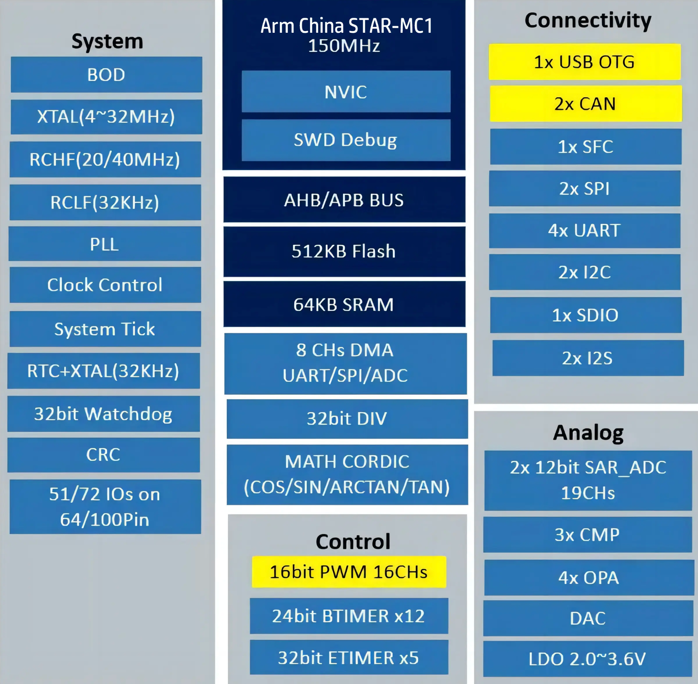

English | [简体中文](README_zh.md)

# swm341-hal

A `no_std` hardware abstraction layer (HAL) for Synwit [**SWM341**](https://www.synwit.cn/pqmcu/) microcontrollers, built on the register definitions from [`swm341-pac`](https://github.com/hysonglet/swm-pacs) and following the `embedded-hal` 1.0 / `embedded-hal-async` 1.0 ecosystem conventions.



## Chip Overview

The SWM341 is a 32-bit microcontroller based on the Arm China STAR-MC1 core. It features high performance, low power consumption and high code density, making it suitable for industrial control, home appliances, motor drives and many other application areas.

The SWM341 embeds an Arm China STAR-MC1 controller with a single-precision floating-point unit (FPU) that supports all ARM single-precision data-processing instructions and data types. It also provides a set of DSP instructions and a memory protection unit (MPU) for improved application security. On-chip 20 MHz/40 MHz clocks with accuracy within 1% can be multiplied by a PLL up to 150 MHz. Multiple on-chip FLASH/SRAM sizes are available, and the SWM34S series offers **2/8/16 MB of stacked SDRAM**. ISP (In-System Programming) and IAP (In-Application Programming) are supported.

Serial peripherals include a CAN interface, multiple UART interfaces, SPI (master/slave/I2S modes) and I2C (master/slave). The chip also provides one 32-bit watchdog timer, five 32-bit advanced timers, twelve 24-bit basic timers, ten independent 16-bit PWM channels, two 12-bit 2.5 MSPS successive-approximation ADC modules with 16 channels in total, a TFT-LCD controller, an SDIO interface, a hardware JPEG decoder, a DAC, an RTC, and an external SDRAM interface controller, together with brown-out detection and low-voltage reset.

## Features

- **Bare-metal `no_std`**: depends only on `cortex-m` / `embedded-hal`, runs without an operating system.
- **Blocking and async modes**: every driver is generic over [`mode::Mode`] — `Blocking` busy-waits, `Async` parks tasks using Embassy's `AtomicWaker`. Both are zero-cost type parameters; the `embassy` feature enables async.
- **Complete interrupt vector table**: the PAC's SVD only describes NVIC vectors `0..=28`, while the silicon implements **91** (`0..=90`). This crate ships its own `vector_table` / `interrupt`, filling in the missing 62 vectors and exposing a unified `ExtendedInterrupt` for drivers to enable/disable IRQs.
- **Singleton-based peripheral management**: `mcu` owns all peripheral and pin singletons, and `init()` hands out `Peripherals` exactly once, guaranteeing unique ownership at the type level.
- **Pin function matrix**: 112 pads bind peripheral alternate functions through the type-level `PinFuncOf<P>`; driver constructors derive the FUNC code from the pin type, preventing miswired pins at compile time.
- **Embassy ecosystem**: implements both `embedded-hal` 1.0 and 0.2.7 traits, and async futures can be handed straight to `embassy-executor`.

## SWM341 Architecture

### Core and build target

| Item | Value |
| ---- | ----- |
| Core | Arm China STAR-MC1 (Armv8-M Mainline, FPU / MPU, Cortex-M33 compatible) |
| Build target | `thumbv8m.main-none-eabihf` (hard-float ABI) |
| Interrupt priority | 3 bits (8 levels, per datasheet; the SVD incorrectly says 2) |
| Max frequency | 150 MHz (internal RC / external crystal PLL) |

### Memory map

The default linker layout is in `memory.x` (all values are `PROVIDE`, so an application can override them with its own `memory.x`):

| Region | Base address | Size | Description |
| ------ | ------------ | ---- | ----------- |
| Flash | `0x0000_0000` | 512 KB | On-chip program flash |
| SRAM | `0x2000_0000` | 64 KB | On-chip SRAM |
| SDRAM | `0x8000_0000` | External | Mapped via the `sdramc` controller, commonly used as framebuffer/heap |
| NOR XIP | `0x7000_0000` | External | AHB mapping window of `sfc` external SPI-NOR, executable in place |

### Clock system

A single system clock drives the CPU and buses; there are no separate AHB/APB prescalers (`src/clock/`):

```
LSI 32k / PLL / LSE 32k / XTAL / HRC ──> CLK mux (optional /8) ──> CLKSEL.SYS ──> Core
```

- PLL formula: `src / indiv * fbdiv * 4 / outdiv`; `MAX_SYSTEM_CLOCK_HZ = 150_000_000`.
- `ClockConfig` presets: `hrc_150mhz()` (12 MHz crystal PLL 3/75/8 → 150 MHz, historical name), `hrc_120mhz()` (3/60/8), `PllConfig::hrc_80mhz()`, `Default` (20 MHz internal RC reset state).
- Init sequence: validate parameters → open `Anac` gate → start the crystal on PA3/PA4 (func 15) if needed → retune flash wait states via a ROM call → switch to HRC → switch to CLK/PLL. The final frequency is cached in `CORE_CLOCK_HZ`.
- Peripheral clock gates are controlled through `PeripheralClockIndex::{open, close, set}` on `SYS.CLKEN0/CLKEN1`; `Dma`, `Hall`, `Acmp` and `Opa` are always on. Each GPIO bank is reference-counted: the clock is enabled on first acquisition and disabled on last release.

### Interrupt system

- `ExtendedInterrupt` (`src/interrupt.rs`) is a `#[repr(u16)]` enum whose discriminants are the real NVIC numbers, covering all 91 vectors; `0..=28` are described by the SVD, `29..=90` are the filled-in ones.
- It provides `enable()` (unsafe, `NVIC::unmask`), `disable()` (`NVIC::mask`) and `number()`. Driver `Instance::irq()` returns this type directly, and futures call `unsafe { T::irq().enable() }` to unmask the IRQ.
- Uppercase alias constants (`UART0`, `GPIOA`, `DMA2D`, `QEI`, …) are used for ISR names and in `device.x`; `device.x` supplies a weak alias per vector, and `vector_table.rs` defines the 91-entry `__INTERRUPTS`.
- **Important**: do not enable the PAC's own `rt` feature — it would inject a shorter (29-entry) vector table that overrides this crate's table.

## On-Chip Resources

Peripherals available as singleton types (`src/mcu.rs`):

| Category | Resources |
| -------- | --------- |
| Pins | 112 pads, banks A/B/C/D/E/M/N × 16 |
| Communication | UART0..3, SPI0..1, I2C0..1, CAN0..1 |
| Timers | TIMR0..4 (24-bit), BTIMR0..11 (32-bit down-counter), PWM0..4 (complementary outputs), WDT |
| Analog | ADC0/1 (12-bit SAR), DAC (PD2), CMP0..2, OPA0..3, HALL |
| Storage | On-chip flash (FMC/IAP), SFC (SPI-NOR + XIP), SDIO, SDRAMC |
| Accelerators / multimedia | DMA (4 channels), DMA2D (2D pixel blit/blend), JPEG decoder, LCDC (parallel RGB, dual layer), CORDIC, DIV, CRC |
| Other | RTC, QEI (quadrature decoder), DWT (core debug), GPIO interrupts |

Module overview: `adc` SAR ADC with async EOC; `btimr` 32-bit down-counters; `can` PeliCAN TX/RX; `cmp` analog comparators; `cordic` Q14 trig/sqrt co-processor; `crc` hardware CRC; `dac` single 12-bit DAC; `div` hardware divide/sqrt; `dma` 4-channel DMA; `dma2d` 2D graphics acceleration; `dwt` core cycle counter/watchpoints; `flash` eFlash erase/program; `gpio` pads/mux/interrupts; `i2c` master + slave; `jpeg` hardware JPEG→YUV/RGB decode; `lcdc` TFT controller; `opa` operational amplifiers; `pwm` PWM; `qei` quadrature encoder; `rtc` real-time clock/alarm; `sdio` SD card host; `sdramc` SDRAM controller; `sfc` SPI-NOR controller; `spi` master + slave; `timr` timers (including HALL dual-edge capture); `uart` serial port.

## Driver Framework

Every register-based peripheral follows a uniform "four-layer trait + five/seven-file" layout, using `uart` as an example:

```
src/uart/
├── instance.rs   # sealed::Instance (regs() + register default methods) + impl_instance_base! + public Instance marker
├── mod.rs        # driver struct Uart<'d, T, Tx, Rx, M>, Blocking/Async APIs
├── pins.rs       # per-pin PinXxxFunc enums implementing UartTxPin<T>/UartRxPin<T> (const FUNC)
├── types.rs      # configuration, errors, interrupt events, etc.
├── tx.rs / rx.rs # transmit/receive logic (split on some peripherals)
└── future.rs     # Async: poll_fn + AtomicWaker + #[no_mangle] ISR
```

### Trait layering

1. **`InstanceBase`** (`src/instance_base.rs`): shared scalar data — `type Block`, clock gate `clock()`, async-state index `index()`, interrupt `irq() -> ExtendedInterrupt`. Due to Rust's associated-type projection limitation, `regs()` is deliberately not on this trait; it stays on each driver's private trait.
2. **`sealed::Instance: InstanceBase`** (in each `instance.rs`): declares `regs() -> *const Block` (the concrete register-block alias) and implements all register operations as default methods, so multiple instances with the same layout (e.g. UART0..3) share one copy of the code.
3. **Public marker `pub trait Instance: sealed::Instance {}`**: driver structs are generic over it, and downstream crates cannot implement it (enforced by the crate-root `Sealed` trait).
4. **`impl_instance_base!($ty, $block, $irq, $clock, $index)`**: sets the Block type, clock gate, index and NVIC vector in one step; reused by 21 register-based peripherals.

**Special peripherals**: `gpio` (two register blocks — `PORTx` for mux and `GPIOx` for data — with the pad as singleton), `dac` / `crc` (registers and clock gate but no interrupt vector), and `sdramc` / `flash` / `dwt` (no NVIC vector or using ROM IAP) do not use the full `InstanceBase` async framework.

### Mode generics and async futures

`Mode` is a sealed trait with two zero-cost flavours: `Blocking` (spin-wait) and `Async` (await). The same driver is monomorphised once per flavour, with no runtime overhead.

The async path uses `embassy_sync::waitqueue::AtomicWaker`: one waker per instance (indexed by `T::index()`). A future built with `poll_fn` first calls `register(cx.waker())`, enables the peripheral's IE bit and unmasks the NVIC, then returns `Pending`; the ISR clears the hardware flag and calls `wake()`. For W1C flags such as ADC/GPIO, which are cleared in the ISR, an atomic latch records the event so no interrupt is lost.

### GPIO pin matrix

Each pad is described by two register blocks: `PORTx` (FUNC0/FUNC1 mux + electrical options) and `GPIOx` (data + interrupts); the HAL treats the pad as the singleton (e.g. `PB0` owns both). `PinFunc::value()` yields the 4-bit FUNC code, and each peripheral's `pins.rs` generates `PinXxxFunc` enums implementing `PinFuncOf<P>` / `XxxPin<T>`, so constructors determine the pin mux at compile time — analog functions are always FUNC 15. Blocking GPIO implements both `embedded-hal` 1.0 and 0.2.7 traits, and the async API provides `wait_for` / `Wait`.

## Quick Start

```rust
use swm341_hal as hal;

#[cortex_m_rt::entry]
fn main() -> ! {
    // 150 MHz system clock; board setup usually also initializes SDRAM before using it as heap/framebuffer.
    let p = hal::init(hal::Config::hrc_150mhz());

    let mut led = hal::gpio::Output::new(p.PB0, hal::gpio::OutputConfig::default());
    loop {
        led.toggle();
    }
}
```

## Cargo Features

| Feature | Default | Description |
| ------- | ------- | ----------- |
| `embassy` | Yes | Enables `Async` driver mode plus `embassy-sync` / `embassy-time` (SysTick 1 kHz time driver). Disabling it keeps only the `Blocking` API and reduces image size. |

## Examples

`examples/` contains a ready-to-flash demo for each peripheral, split into two groups (async examples are marked `required-features = ["embassy"]` in `Cargo.toml`).

**Blocking (bare-metal `main`, `cortex-m-rt`)**

| Example | Description |
| ------- | ----------- |
| `hello_rtt` | Minimal RTT print template |
| `clock_block` / `dwt_block` | Clock tree (cached value and hardware readback) / DWT cycle counter and watchpoints |
| `gpio_block` / `uart_block` | Button driving an LED / UART2 loopback |
| `spi_block` / `spi_slave` / `i2c_block` / `i2c_slave` | Blocking SPI / I2C master and slave (GT911 touch, EEPROM) |
| `timr_block` / `pwm_block` / `adc_block` / `cmp_block` / `qei_block` / `hall_block` | Timer / PWM / ADC / comparator / quadrature encoder / hall sensor speed measurement |
| `wdt_block` / `rtc_block` | Watchdog feeding / real-time clock read-write |
| `can_block` / `crc_block` / `div_block` / `cordic_block` / `opa_block` | CAN frame TX / hardware CRC / divide and sqrt / CORDIC / op-amps |
| `flash_block` / `sfc_flash_id` / `sfc_block` / `sfc_xip` | On-chip flash erase/program / NOR read ID and erase-write verify / execute-in-place |
| `sdramc_block` / `sdio_block` | SDRAM mapped-window read-write / SD card init and block read-write |
| `lcdc_block` / `lcdc_gradient` | TFT-LCD bring-up (SDRAM framebuffer) / gradient animation |
| `dma_block` | Memory-to-memory copy on DMA channel 0 |

**Async (`embassy_executor::main`, requires the `embassy` feature)**

| Example | Description |
| ------- | ----------- |
| `embassy_gpio_blink` / `embassy_gpio_exti` | Blink LED and count button presses / park until a GPIO interrupt fires |
| `embassy_spi` / `embassy_spi_slave` / `spi_dual` | Async SPI read flash ID / slave loopback / concurrent master-slave dual-SPI |
| `embassy_i2c` / `embassy_i2c_slave` | Async I2C read EEPROM / slave loopback |
| `embassy_timr` / `embassy_pwm` / `embassy_adc` / `embassy_uart` | Timer (verified with `embassy_time`) / await each PWM period / ADC EOC / UART loopback |
| `embassy_lcdc` | Frame-paced LCD gradient animation |

Run an example (the default target is pinned in `.cargo/config.toml`):

```sh
cargo run --example hello_rtt
cargo run --example embassy_lcdc   # requires the embassy feature (enabled by default)
```

## Build and Run

- `.cargo/config.toml` pins `target = thumbv8m.main-none-eabihf` and `link-arg=-Tlink.x`, and sets `runner = "probe-rs run --chip swm341"`, so `cargo run` flashes the firmware and shows `rprintln!` output over RTT.
- `build.rs` copies `device.x` and `memory.x` into `OUT_DIR` and adds it to the linker search path.
- Host unit tests (only cover hardware-independent arithmetic and argument checks; a `no_std` target has no `test` crate, so the host triple must be given explicitly):

  ```sh
  cargo test --target aarch64-apple-darwin --lib
  ```

- Build a blocking-only image without Embassy: `cargo check --no-default-features`.

## Repository Layout

```
swm341-hal/
├── src/                # HAL sources, 34 public modules (see lib.rs)
│   ├── instance_base.rs / mode.rs / interrupt.rs / mcu.rs / clock/ / gpio/
│   └── <peripheral>/   # each: instance.rs + mod.rs + pins.rs + types.rs + future.rs (+ tx.rs/rx.rs)
├── examples/           # 44 ready-to-flash examples (Blocking + Async)
├── doc/                # local reference: datasheet PDF/text, board schematics (not compiled)
├── scripts/            # generators for pin FUNC tables and vector tables from vendor headers
├── build.rs            # copies device.x / memory.x into OUT_DIR
├── device.x            # weak aliases for the 91 NVIC vectors
├── memory.x            # default Flash / SRAM layout (overridable)
└── .cargo/config.toml  # target triple, linker args, probe-rs runner
```

## References

- Many drivers and examples in this HAL are ported from the Synwit vendor library `SWM341_Lib` and the *SWM341 Datasheet*. Obtain the matching version of the vendor library and datasheet from official Synwit channels if you need to consult them.
- Synwit official forum resource roundup: <https://bbs.synwit.cn/forum.php?mod=viewthread&tid=3&page=1&>

## License

[Apache License 2.0](https://www.apache.org/licenses/LICENSE-2.0)
