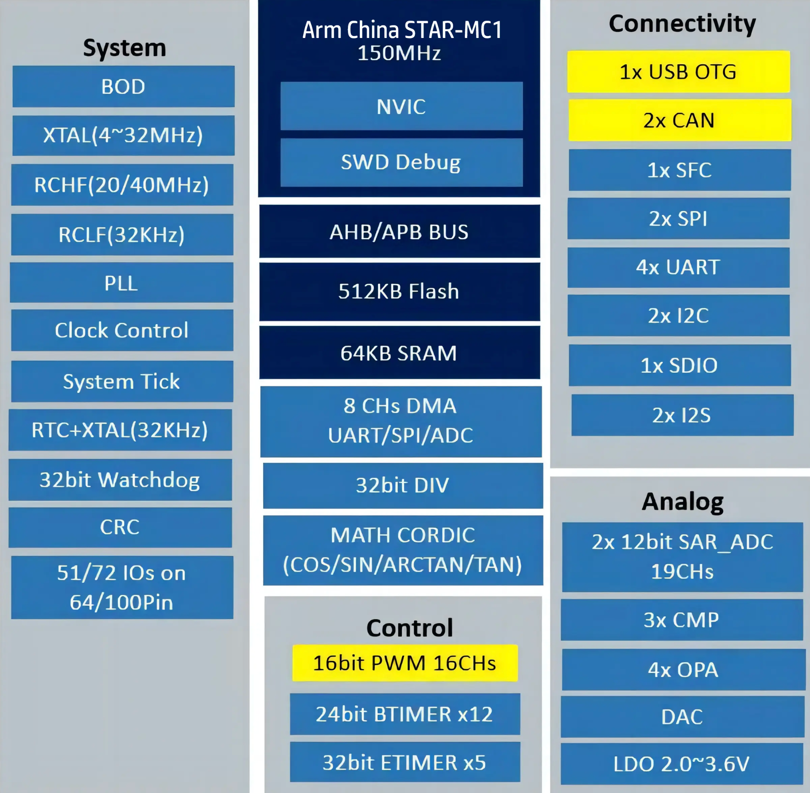

[English](README.md) | 简体中文

# swm341-hal

Synwit（华芯微特）[**SWM341**](https://www.synwit.cn/pqmcu/) 系列微控制器的 `no_std` 硬件抽象层（HAL），基于 [`swm341-pac`](https://github.com/hysonglet/swm-pacs) 的寄存器定义构建，遵循 `embedded-hal` 1.0 / `embedded-hal-async` 1.0 生态约定。



## 芯片简介

SWM341 是一款基于 Arm China STAR-MC1 的 32 位微控制器。具有高性能、低功耗、代码密度大等突出特点，适用于工业控制、白色家电、电机驱动等诸多应用领域。

SWM341 内嵌 Arm China STAR-MC1 控制器，带有单精度浮点运算单元(FPU)，支持所有 ARM 单精度数据处理指令和数据类型。它还具有一组 DSP 指令和提高应用安全性的一个存储器保护单元(MPU)。片上包含精度为 1%以内的 20MHz/40MHz 时钟，可通过 PLL 倍频到 150MHz 时钟，提供多种内置 FLASH/SRAM 大小可供选择，SWM34S 系列分别叠封 **2/8/16MBytes SDRAM** 可供选择，支持 ISP（在系统编程）操作及 IAP（在应用编程）。

外设串行总线包括 CAN 接口，多个 UART 接口、SPI 通信接口（支持主/从/I2S 模式选择）及 I2C 接口（支持主/从选择）。此外还包括 1 个 32 位看门狗定时器，5 组 32 位加强型定时器，12 组 24 位基础型定时器，10 路独立通道 16 位的 PWM 发生器，2 个共计 16 通道 12 位、2.5MSPS 的逐次逼近型 ADC 模块，1 个 TFT-LCD 液晶驱动模块、1 个 SDIO 接口、一个图像硬解码器 JPEG、一个数模转换 DAC 模块、1 个 RTC 实时时钟以及 1 个外接 SDRAM 接口控制模块，同时提供欠压检测及低电压复位功能。

## 仓库功能

- **裸机 `no_std`**：仅依赖 `cortex-m` / `embedded-hal`，可运行在无操作系统环境。
- **同步 / 异步双模式**：每个驱动泛型于 [`mode::Mode`]：`Blocking` 忙等，`Async` 基于 Embassy 的 `AtomicWaker` 挂起任务；二者是零成本的类型参数，`embassy` feature 开启异步。
- **完整的中断向量表**：PAC 的 SVD 只描述 NVIC 向量 `0..=28`，芯片实际有 **91 个**（`0..=90`）。本 crate 自带 `vector_table` / `interrupt`，补全缺失的 62 个向量，并暴露统一的 `ExtendedInterrupt` 供驱动开关中断。
- **单例式外设管理**：`mcu` 持有所有外设/引脚单例，`init()` 一次性发放 `Peripherals`，从类型层面保证外设唯一所有权。
- **引脚功能矩阵**：112 个焊盘通过类型级的 `PinFuncOf<P>` 绑定外设复用功能，驱动构造函数从引脚类型推导 FUNC 编码，编译期防止接错引脚。
- **Embassy 生态**：`embedded-hal` 1.0 与 0.2.7 双版本 trait 实现，异步 Future 可直接交给 `embassy-executor`。

## SWM341 芯片框架

### 内核与编译目标

| 项目       | 值                                                                 |
| ---------- | ------------------------------------------------------------------ |
| 内核       | Arm China STAR-MC1（Armv8-M Mainline，FPU / MPU，兼容 Cortex-M33） |
| 编译目标   | `thumbv8m.main-none-eabihf`（硬浮点 ABI）                          |
| 中断优先级 | 3 bit（8 级，数据手册口径；SVD 误写为 2 bit）                      |
| 主频       | 最高 150 MHz（内部 RC / 外部晶振 PLL）                             |

### 存储器映射

默认链接布局见 `memory.x`（均为 `PROVIDE`，应用可用自己的 `memory.x` 覆盖）：

| 区域    | 基址          | 大小   | 说明                                           |
| ------- | ------------- | ------ | ---------------------------------------------- |
| Flash   | `0x0000_0000` | 512 KB | 片上程序 Flash                                 |
| SRAM    | `0x2000_0000` | 64 KB  | 片上 SRAM                                      |
| SDRAM   | `0x8000_0000` | 外部   | 经 `sdramc` 控制器映射，常用作帧缓冲/堆        |
| NOR XIP | `0x7000_0000` | 外部   | `sfc` 外部 SPI-NOR 的 AHB 映射窗口，可就地执行 |

### 时钟系统

单一系统时钟驱动 CPU 与总线，无独立 AHB/APB 分频（`src/clock/`）：

```
LSI 32k / PLL / LSE 32k / XTAL / HRC ──> CLK mux (可选 /8) ──> CLKSEL.SYS ──> Core
```

- PLL 公式：`src / indiv * fbdiv * 4 / outdiv`；`MAX_SYSTEM_CLOCK_HZ = 150_000_000`。
- `ClockConfig` 预设：`hrc_150mhz()`（12 MHz 晶振 PLL 3/75/8 → 150 MHz，历史命名）、`hrc_120mhz()`（3/60/8）、`PllConfig::hrc_80mhz()`、`Default`（20 MHz 内部 RC 复位态）。
- 初始化顺序：校验参数 → 开 `Anac` 门 → 必要时在 PA3/PA4（func 15）起振 → ROM 调用重设 Flash 等待周期 → 切 HRC → 切 CLK/PLL，最终频率缓存于 `CORE_CLOCK_HZ`。
- 外设时钟门由 `PeripheralClockIndex::{open, close, set}` 操作 `SYS.CLKEN0/CLKEN1`；`Dma`、`Hall`、`Acmp`、`Opa` 为常开。GPIO 每个 Bank 引用计数，首次获取开钟、最后释放关钟。

### 中断系统

- `ExtendedInterrupt`（`src/interrupt.rs`）是 `#[repr(u16)]` 枚举，判别值即真实 NVIC 号，覆盖全部 91 个向量；`0..=28` 为 SVD 已描述向量，`29..=90` 为补全向量。
- 提供 `enable()`（unsafe，`NVIC::unmask`）、`disable()`（`NVIC::mask`）、`number()`；驱动的 `Instance::irq()` 直接返回该类型，Future 中调用 `unsafe { T::irq().enable() }` 开中断。
- 大写别名常量（`UART0`、`GPIOA`、`DMA2D`、`QEI`…）用于 ISR 函数名与 `device.x`；`device.x` 为每个向量提供弱别名，`vector_table.rs` 定义 91 项的 `__INTERRUPTS`。
- **注意**：不要启用 PAC 自身的 `rt` feature，否则会注入一份更短（29 项）的向量表覆盖本 crate 的表。

## 芯片资源

由单例类型可得的外设清单（`src/mcu.rs`）：

| 类别        | 资源                                                                                         |
| ----------- | -------------------------------------------------------------------------------------------- |
| 引脚        | 112 个焊盘，Bank A/B/C/D/E/M/N × 16                                                          |
| 通信        | UART0..3、SPI0..1、I2C0..1、CAN0..1                                                          |
| 定时器      | TIMR0..4（24 位）、BTIMR0..11（32 位递减）、PWM0..4（互补输出）、WDT                         |
| 模拟        | ADC0/1（12 位 SAR）、DAC（PD2）、CMP0..2、OPA0..3、HALL                                      |
| 存储        | 片上 Flash（FMC/IAP）、SFC（SPI-NOR + XIP）、SDIO、SDRAMC                                    |
| 加速/多媒体 | DMA（4 通道）、DMA2D（2D 像素搬移/混合）、JPEG 解码、LCDC（并行 RGB 双层）、CORDIC、DIV、CRC |
| 其他        | RTC、QEI（正交解码）、DWT（内核调试）、GPIO 中断                                             |

各模块简述：`adc` 带异步 EOC 的 SAR ADC；`btimr` 32 位递减计数；`can` PeliCAN 收发；`cmp` 模拟比较器；`cordic` Q14 三角/开方协处理器；`crc` 硬件 CRC；`dac` 单路 12 位 DAC；`div` 硬件除法/开方；`dma` 4 通道 DMA；`dma2d` 2D 图形加速；`dwt` 内核周期计数/观察点；`flash` eFlash 擦写；`gpio` 焊盘/复用/中断；`i2c` 主从；`jpeg` 硬解 JPEG→YUV/RGB；`lcdc` TFT 控制器；`opa` 运放；`pwm` PWM；`qei` 正交编码；`rtc` 实时时钟/闹钟；`sdio` SD 卡主机；`sdramc` SDRAM 控制器；`sfc` SPI-NOR 控制器；`spi` 主从；`timr` 定时器（含 HALL 双沿捕获）；`uart` 串口。

## 当前驱动框架

每个寄存器型外设统一采用「四层 trait + 五/七文件」布局，以 `uart` 为例：

```
src/uart/
├── instance.rs   # sealed::Instance（regs() + 寄存器默认方法）+ impl_instance_base! + 公共 Instance marker
├── mod.rs        # 驱动结构体 Uart<'d, T, Tx, Rx, M>、Blocking/Async 两套 API
├── pins.rs       # 各引脚的 PinXxxFunc 枚举，实现 UartTxPin<T>/UartRxPin<T>（const FUNC）
├── types.rs      # 配置、错误、中断事件等类型
├── tx.rs / rx.rs # 发送/接收逻辑（部分外设拆分）
└── future.rs     # Async 模式的 poll_fn + AtomicWaker + #[no_mangle] ISR
```

### trait 分层

1. **`InstanceBase`**（`src/instance_base.rs`）：公共标量信息——`type Block`、时钟门 `clock()`、异步状态索引 `index()`、中断 `irq() -> ExtendedInterrupt`。受 Rust 关联类型投影限制，`regs()` 不在此 trait，而留在具体驱动的私有 trait 中。
2. **`sealed::Instance: InstanceBase`**（每个 `instance.rs`）：声明 `regs() -> *const Block`（具体寄存器块别名），并以默认方法集中实现该外设所有寄存器操作，让同布局的多个实例（如 UART0..3）共享一份代码。
3. **公共 marker `pub trait Instance: sealed::Instance {}`**：驱动结构体泛型于它，外部无法自定义实现（受 crate 根 `Sealed` 约束）。
4. **`impl_instance_base!($ty, $block, $irq, $clock, $index)`**：一步写入 Block 类型、时钟门、索引、NVIC 向量，21 个寄存器型外设复用该宏。

**特殊外设**：`gpio`（`PORTx` 复用 + `GPIOx` 数据两套块，以焊盘为单例）、`dac` / `crc`（有寄存器与时钟门但无中断向量）、`sdramc` / `flash` / `dwt`（无 NVIC 向量或走 ROM IAP），它们不套用完整的 `InstanceBase` 异步框架。

### Mode 泛型与异步 Future

`Mode` 是 sealed trait，两个零成本 flavour：`Blocking`（自旋等待）、`Async`（await）。同一驱动分别单态化一份，无运行时开销。

异步路径使用 `embassy_sync::waitqueue::AtomicWaker`：每个实例一个 waker（按 `T::index()` 索引），Future 用 `poll_fn` 先 `register(cx.waker())`、使能外设 IE、打开 NVIC，再返回 `Pending`；ISR 清硬件标志后 `wake()`。ADC/GPIO 等 W1C 标志会在 ISR 中被清除，因此额外用原子量闩存事件，避免丢中断。

### GPIO 引脚矩阵

每个焊盘由 `PORTx`（FUNC0/FUNC1 复用 + 电气属性）与 `GPIOx`（数据 + 中断）两个寄存器块描述，HAL 以焊盘为单例（如 `PB0` 同时拥有两者）。`PinFunc::value()` 给出 4 位 FUNC 编码，外设的 `pins.rs` 生成 `PinXxxFunc` 枚举并实现 `PinFuncOf<P>` / `XxxPin<T>`，构造函数据此在编译期确定引脚复用——模拟功能固定为 FUNC 15。同步 GPIO 实现 `embedded-hal` 1.0 与 0.2.7 trait，异步提供 `wait_for` / `Wait`。

## 快速开始

```rust
use swm341_hal as hal;

#[cortex_m_rt::entry]
fn main() -> ! {
    // 150 MHz 系统时钟；板级通常还需初始化 SDRAM 才可用作堆/帧缓冲。
    let p = hal::init(hal::Config::hrc_150mhz());

    let mut led = hal::gpio::Output::new(p.PB0, hal::gpio::OutputConfig::default());
    loop {
        led.toggle();
    }
}
```

## Cargo features

| feature   | 默认 | 说明                                                                                                                               |
| --------- | ---- | ---------------------------------------------------------------------------------------------------------------------------------- |
| `embassy` | 是   | 启用 `Async` 驱动模式以及 `embassy-sync` / `embassy-time`（SysTick 1 kHz 时间驱动）支持。关闭后仅保留 `Blocking` API，可减小镜像。 |

## 示例

`examples/` 下每个外设都有可直接烧录的演示，分为两类（异步示例在 `Cargo.toml` 中标注 `required-features = ["embassy"]`）。

**Blocking（裸机 `main`，`cortex-m-rt`）**

| 示例                                                                                | 说明                                                 |
| ----------------------------------------------------------------------------------- | ---------------------------------------------------- |
| `hello_rtt`                                                                         | RTT 打印的最小模板                                   |
| `clock_block` / `dwt_block`                                                         | 时钟树（缓存值与硬件读回）/ DWT 周期计数与观察点     |
| `gpio_block` / `uart_block`                                                         | 按键驱动 LED / UART2 回环                            |
| `spi_block` / `spi_slave` / `i2c_block` / `i2c_slave`                               | 同步 SPI / I2C 主从（含 GT911 触摸、EEPROM）         |
| `timr_block` / `pwm_block` / `adc_block` / `cmp_block` / `qei_block` / `hall_block` | 定时 / PWM / ADC / 比较器 / 正交编码 / 霍尔测速      |
| `wdt_block` / `rtc_block`                                                           | 看门狗喂狗 / 实时时钟读写                            |
| `can_block` / `crc_block` / `div_block` / `cordic_block` / `opa_block`              | CAN 发帧 / 硬件 CRC / 除法开方 / CORDIC / 运放       |
| `flash_block` / `sfc_flash_id` / `sfc_block` / `sfc_xip`                            | 片内 Flash 擦写 / NOR 读 ID、擦写校验 / XiP 就地执行 |
| `sdramc_block` / `sdio_block`                                                       | SDRAM 映射窗口读写 / SD 卡初始化与块读写             |
| `lcdc_block` / `lcdc_gradient`                                                      | TFT-LCD 点亮（SDRAM 帧缓冲）/ 渐变动画               |
| `dma_block`                                                                         | DMA 通道 0 内存到内存拷贝                            |

**Async（`embassy_executor::main`，需 `embassy` feature）**

| 示例                                                            | 说明                                                              |
| --------------------------------------------------------------- | ----------------------------------------------------------------- |
| `embassy_gpio_blink` / `embassy_gpio_exti`                      | LED 闪烁与按键计数 / 等待 GPIO 中断                               |
| `embassy_spi` / `embassy_spi_slave` / `spi_dual`                | 异步 SPI 读 Flash ID / 从机回环 / 主从双线并发                    |
| `embassy_i2c` / `embassy_i2c_slave`                             | 异步 I2C 读 EEPROM / 从机回环                                     |
| `embassy_timr` / `embassy_pwm` / `embassy_adc` / `embassy_uart` | 定时（用 `embassy_time` 校验）/ PWM 周期等待 / ADC EOC / 串口回环 |
| `embassy_lcdc`                                                  | 逐帧节奏的 LCD 渐变动画                                           |

运行某个示例（默认目标已在 `.cargo/config.toml` 固定）：

```sh
cargo run --example hello_rtt
cargo run --example embassy_lcdc   # 需要 embassy feature（默认开启）
```

## 构建与运行

- `.cargo/config.toml` 固定 `target = thumbv8m.main-none-eabihf`、`link-arg=-Tlink.x`，并配置 `runner = "probe-rs run --chip swm341"`，因此 `cargo run` 会烧录并通过 RTT 输出 `rprintln!` 内容。
- `build.rs` 将 `device.x`、`memory.x` 拷贝进 `OUT_DIR` 并加入链接搜索路径。
- 主机单元测试（仅覆盖不涉及硬件的算术与参数检查；`no_std` 目标无 `test` crate，需显式指定本机 triple）：

  ```sh
  cargo test --target aarch64-apple-darwin --lib
  ```

- 关闭 Embassy 编译 Blocking-only 镜像：`cargo check --no-default-features`。

## 仓库结构

```
swm341-hal/
├── src/                # HAL 源码，34 个公共模块（见 lib.rs）
│   ├── instance_base.rs / mode.rs / interrupt.rs / mcu.rs / clock/ / gpio/
│   └── <peripheral>/   # 每个外设：instance.rs + mod.rs + pins.rs + types.rs + future.rs (+ tx.rs/rx.rs)
├── examples/           # 44 个可烧录示例（Blocking + Async）
├── doc/                # 本地参考：数据手册 PDF/文本、板级原理图（不参与编译）
├── scripts/            # 从厂商头文件生成引脚 FUNC 表与向量表的脚本
├── build.rs            # 拷贝 device.x / memory.x 至 OUT_DIR
├── device.x            # 91 个 NVIC 向量的弱别名
├── memory.x            # Flash / SRAM 默认布局（可覆盖）
└── .cargo/config.toml  # 目标 triple、链接参数、probe-rs runner
```

## 参考

- 本 HAL 的不少驱动与示例移植自华芯微特厂商库`SWM341_Lib`，及《SWM341 数据手册》。如需查阅请自行从华芯微特官方渠道获取对应版本的厂商库与数据手册。
- 华芯微特官方论坛资料汇总：<https://bbs.synwit.cn/forum.php?mod=viewthread&tid=3&page=1&>

## License

[Apache License 2.0](https://www.apache.org/licenses/LICENSE-2.0)
